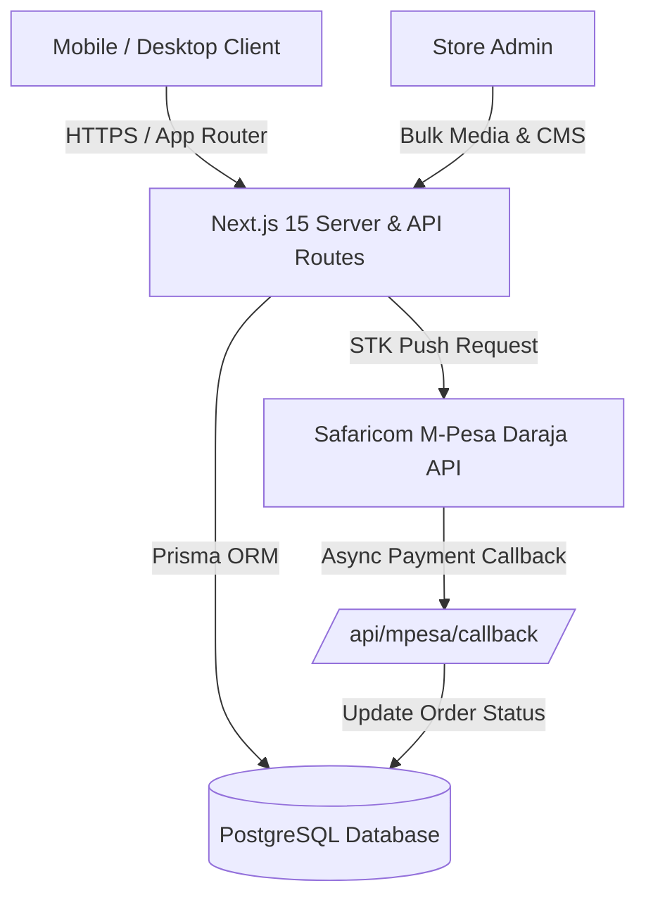

# JR E-Commerce Platform 🛍️


A production-ready, mobile-first e-commerce platform engineered for the Kenyan retail market. Built with **Next.js 15**, **Prisma**, and **PostgreSQL**, featuring automated **M-Pesa Daraja STK Push** payments, a custom headless CMS, and an administrative inventory dashboard.

---

## 🏗️ System Architecture



---

## ⚙️ Core Engineering Highlights
* **Asynchronous M-Pesa Payment Pipeline:** Initiates Safaricom STK Push prompts and processes asynchronous payment callbacks idempotently to prevent duplicate order fulfillment.
* **Type-Safe Data Layer:** Uses Prisma ORM with PostgreSQL schemas enforcing referential integrity across products, variants, orders, and customer records.
* **Custom Headless CMS & Bulk Media Pipeline:** Enables store administrators to upload product catalogs in bulk, manage stock thresholds, and update storefront banners without code changes.
* **Automated CI/CD Verification:** Configured with GitHub Actions to run strict TypeScript type-checking (`tsc --noEmit`) and production build verification on every push.

---

## 🚀 Local Development Setup

1. **Clone the repository:**
   ```bash
   git clone https://github.com/Lerrick005/jr-ecommerce.git
   cd jr-ecommerce
   ```

2. **Install dependencies:**
   ```bash
   npm install --legacy-peer-deps
   ```

3. **Configure environment variables:**
   Copy `.env.example` to `.env.local` and add your `DATABASE_URL` and M-Pesa Daraja API credentials.

4. **Push database schema and start development server:**
   ```bash
   npx prisma db push
   npm run dev
   ```
